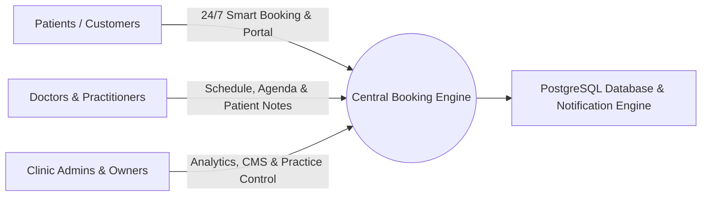
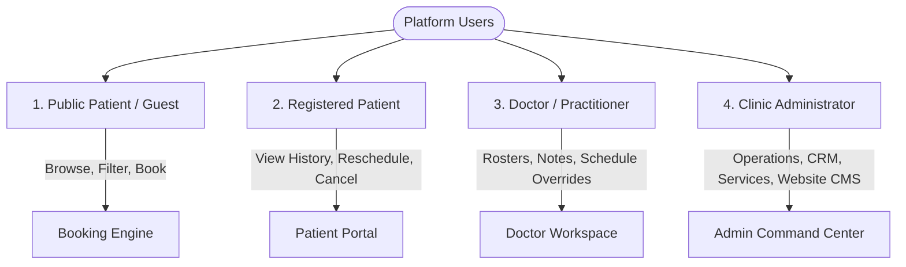
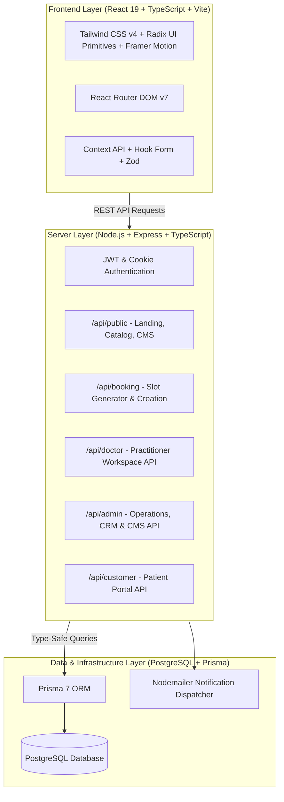
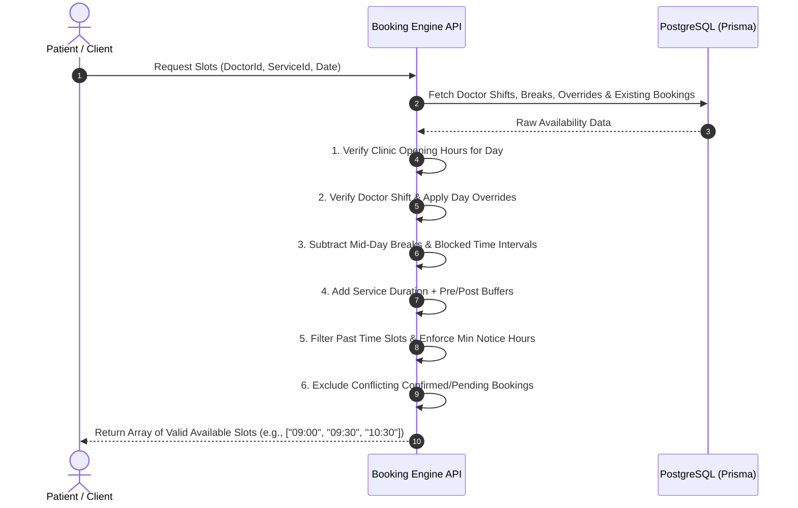
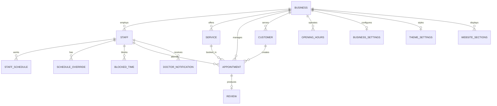

# Comprehensive Purpose & System Specification Document
**Project:** Clinical & Healthcare Appointment Booking & Management Platform  
**Document Version:** 1.0.0  
**Target Domain:** Medical, Dental, Wellness & Appointment-Driven Healthcare Practices  

---

## 1. Executive Summary & Vision

### 1.1 The Core Mission
The **Booking Platform** is an enterprise-grade, end-to-end appointment scheduling, clinic management, and patient engagement ecosystem. It is engineered specifically for appointment-driven medical and healthcare institutions—primarily dental clinics, specialist practices, wellness centers, and outpatient facilities.

The platform bridges the critical operational gap between **patients seeking frictionless healthcare access** and **clinics requiring robust, automated administrative workflows**.

### 1.2 Primary Value Proposition
- **For Patients:** Instant 24/7 self-service scheduling with transparent pricing, practitioner credentials, real-time slot calculation, and self-management portals.
- **For Doctors / Specialists:** A streamlined private workspace to manage daily rosters, track appointments, review patient history, log clinical notes, and control working shifts without administrative friction.
- **For Clinic Administrators & Owners:** A centralized operational dashboard providing real-time revenue analytics, comprehensive appointment lifecycle controls, staff coordination, visual website CMS customization, and automated customer communications.

---

## 2. Core Problems & How the Platform Solves Them

| Problem in Traditional Clinics | Platform Solution & Impact |
| :--- | :--- |
| **High No-Show Rates & Missed Appointments** | Automated booking confirmations, multi-channel reminders, and unique confirmation codes to keep patients informed and accountable. |
| **Phone Booking Bottlenecks & Human Scheduling Errors** | Real-time smart slot engine that dynamically computes availability based on doctor shifts, break times, procedure durations, buffer intervals, and notice restrictions. |
| **Double Bookings & Scheduling Conflicts** | Relational schedule validation at the database and API levels, preventing concurrent appointments for the same practitioner or overlapping room resources. |
| **Fragmented Staff Rosters & Unplanned Time Off** | Dedicated practitioner schedules with recurring weekly shifts, break periods, day-specific schedule overrides, and custom blocked-time windows. |
| **Disconnected Marketing & Website Updates** | Built-in Clinic CMS allowing non-technical managers to edit homepage sections, update dentist profiles, toggle services, moderate reviews, and customize theme colors without touching code. |
| **Terminology Inflexibility** | Adaptable terminology settings allowing the system to seamlessly transform between dental ("Dentist / Patient / Treatment"), general medical ("Doctor / Patient / Consultation"), or wellness ("Therapist / Client / Service"). |

---

## 3. Detailed Stakeholder Profiles & Portals

### 3.1 Public Patient Experience (Front-of-House)
The public interface serves as a high-converting digital storefront and booking portal:
- **Homepage:** Clinic introduction, trust stats, highlighted treatments, featured specialists, patient reviews/testimonials, location map, and interactive FAQs.
- **Treatments Catalog (`/treatments`):** Comprehensive service directory categorized by procedure type, displaying pricing, durations, detailed descriptions, and direct booking triggers.
- **Specialist Directory (`/dentists`):** In-depth practitioner profiles highlighting credentials, educational background, years of experience, spoken languages, and specialties.
- **Interactive Multi-Step Booking Wizard (`/booking`):**
  1. *Service Selection:* Filter and pick specific treatments.
  2. *Doctor Selection:* Choose any available doctor or a specific preferred practitioner.
  3. *Date & Time Selection:* Interactive calendar with live slot calculation based on practitioner availability.
  4. *Patient Information:* Contact details, medical background, and special requests.
  5. *Confirmation:* Instant generation of a unique `confirmationCode`, booking overview, and automated notification triggers.
- **Location & Contact:** Interactive clinic mapping with geographical coordinates, opening hours, contact channels, and driving directions.

### 3.2 Patient Self-Service Portal (`/portal`)
- **Booking Overview:** Real-time visibility into pending, confirmed, and completed consultations.
- **Self-Management:** Instant ability to cancel or reschedule appointments within clinic-defined policy windows (e.g., up to 24 hours in advance).
- **History & Reviews:** Access past treatment history and submit verified reviews for visited practitioners and received services.

### 3.3 Doctor / Practitioner Workspace (`/doctor`)
A dedicated portal optimized for healthcare providers:
- **Provider Dashboard:** At-a-glance summary of today's roster, upcoming patients, pending requests, and key performance metrics.
- **Appointment Roster & Detail:** Full chronological list of consultations with patient notes, medical intake details, and the ability to append private practitioner notes.
- **Status Progression:** Direct controls to advance appointments from `PENDING` $\rightarrow$ `CONFIRMED` $\rightarrow$ `IN_PROGRESS` $\rightarrow$ `COMPLETED` or `NO_SHOW`.
- **Personal Schedule & Shift Manager:** Configure weekly working days, start/end times, lunch and mid-day breaks.
- **Time-Off & Overrides:** Block out specific vacation days, emergency leaves, or custom hours with automated blocking of patient booking slots.
- **Provider Notifications:** Real-time in-app alerts and notifications when a new patient books, cancels, or reschedules.

### 3.4 Clinic Administrator Command Center (`/admin`)
The centralized backoffice for comprehensive clinic governance:
- **Executive Analytics:** Real-time KPIs including total bookings, revenue estimates, patient volume, top-performing services, and practitioner utilization rates.
- **Master Appointment Manager:** Filter, search, and manage all clinic bookings across all doctors with status overrides, cancellation handling, and audit trails.
- **Master Visual Calendar:** Interactive Day, Week, and Month view displaying all staff schedules side-by-side to prevent overlaps and identify open clinic capacities.
- **Service & Category Management:** Create, organize, price, and toggle treatments, including setting preparation buffers (`bufferBeforeMinutes`, `bufferAfterMinutes`) and duration limits.
- **Staff & Practitioner Management:** Add new doctors, assign them to specific services, manage public profiles, credentials, photos, and linked user accounts.
- **Customer CRM:** Centralized patient directory tracking contact information, total visits, lifetime appointments, and private administrative notes.
- **Review Moderation System:** Screen and approve/reject patient reviews before public display to maintain verified feedback.
- **Visual Website CMS Editor:** Full visual control over public sections (Hero, About, Why Choose Us, Gallery, Testimonials, FAQs, Booking CTA) with reordering and content toggles.
- **Clinic Location & Map Management:** Configure address, map coordinates (`latitude`, `longitude`, `mapZoom`), parking info, and public transit directions.
- **Appearance & Theming:** Switch clinic visual themes (`Clinical Swiss`, `Premium Soft`, `Dark Clinical`), primary/accent color schemes, font pairings, and UI border radii.
- **Business Settings & Scheduling Rules:** Configure minimum notice hours (e.g., 2 hours before booking), maximum booking advance horizon (e.g., 90 days), slot step intervals (15/30/60 mins), cancellation windows, and custom SMTP email server integrations.

---

## 4. System Architecture & Technical Specifications

### 4.1 Technology Stack Summary
- **Frontend:** React 19, TypeScript, Vite, Tailwind CSS v4, Lucide React, Framer Motion, Base UI / Radix primitives, Sonner notifications.
- **Backend:** Node.js, Express.js (TypeScript via TSX), JSON Web Tokens (JWT), Cookie Parser, Bcrypt.js, Multer file upload handling.
- **Database & Data Layer:** PostgreSQL, Prisma 7 ORM with relational schema mappings, connection pooling with `@prisma/adapter-pg`.
- **Validation & Security:** Zod schema validation on client and server, role-based access control (`ADMIN`, `STAFF`, `CUSTOMER`), sanitized inputs, and hashed credentials.
- **Communication:** Nodemailer SMTP engine for automated confirmation emails, cancellations, and reminder dispatches.

---

## 5. Intelligent Scheduling & Slot Engine Architecture

The platform's core algorithmic feature is its **conflict-free dynamic slot engine**. It ensures that no invalid, overlapped, or out-of-bounds appointment can ever be booked.

---

## 6. Comprehensive Data Model Entities

The platform's data layer is built on a normalized relational architecture in PostgreSQL:

### Entity Matrix
1. **User & Auth:** Multi-role authentication (`ADMIN`, `STAFF`, `CUSTOMER`) with password hashing and session tokens.
2. **Business:** Multi-attribute business profile with coordinates, currency symbols (`₱`, `$`, etc.), timezone handling, and branding assets.
3. **Staff (Doctors):** Professional records including biography, certifications, specialty tags, photo galleries, and notification preferences.
4. **Services & Categories:** Tiered pricing, execution durations, buffer periods, and practitioner-to-service mapping (`StaffService`).
5. **Schedules & Overrides:** Granular shift definitions, break windows, and ad-hoc day overrides for holidays or leaves.
6. **Appointments:** Central booking records tracking status (`PENDING`, `CONFIRMED`, `IN_PROGRESS`, `COMPLETED`, `CANCELLED`, `NO_SHOW`), price snapshots, practitioner notes, and cancellation reasons.
7. **Reviews & Testimonials:** Patient feedback loops with star ratings, comments, verification badges, and administrative moderation states.
8. **Doctor Notifications:** In-app notification queue for immediate doctor situational awareness.
9. **CMS & Section Engine:** Dynamic JSON-based storage for configurable landing page sections.

---

## 7. Strategic Impact & Future Roadmap

### 7.1 Operational Impact
- **90%+ Reduction in Scheduling Overhead:** Eliminates manual back-and-forth communication.
- **Zero Double-Bookings:** Automated mathematical slot computation guarantees slot isolation.
- **Enhanced Patient Retention:** Modern, frictionless UI elevates clinic credibility and trust.
- **Complete Practice Visibility:** Clinic owners gain real-time insight into revenue, doctor productivity, and patient trends.

### 7.2 Scalability & Extensibility Roadmap
- **Payment Gateway Integration:** Direct deposit and full pre-payment processing via Stripe, PayPal, or local e-wallets (e.g., GCash, Maya).
- **Multi-Location / Multi-Branch Expansion:** Support for clinic chains with branch selection and doctor transfer schedules.
- **Automated SMS & WhatsApp Reminders:** Native SMS gateway integration (Twilio / Infobip) for direct mobile alerts.
- **Electronic Medical Records (EMR) & Prescriptions:** Digital prescription generation, dental chart mapping, and patient document attachments.
- **Telehealth & Virtual Consultations:** Integrated WebRTC video room creation for remote medical assessments.

---

*Document compiled and maintained for the Booking Platform codebase.*
